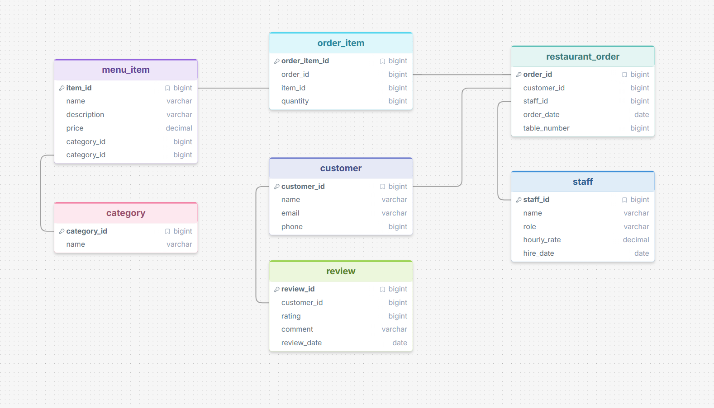

# Restaurant Database

This project models data for a restaurant, including the menu, customer orders, staff, and reviews. It can answer questions about popular items, staff performance, customer spending, and more.



## Query I thought it did well on

**Question**: How many people ordered the Lemonade?

**GPT SQL Response**:
```sql
SELECT COUNT(DISTINCT ro.customer_id) AS num_customers
FROM restaurant_order ro
JOIN order_item oi ON ro.order_id = oi.order_id
JOIN menu_item  mi ON oi.item_id  = mi.item_id
WHERE mi.name = 'Lemonade';
```

**Raw Result**: `[(2,)]`

**Friendly Response**: 2 customers ordered the Lemonade — Ben Nguyen and Emma Patel.

It correctly handled the three-table join needed to trace a menu item all the way back to the customers who ordered it, and used DISTINCT so customers who ordered it more than once were only counted once.

## Question that it tripped up on

A question that tripped it up was: "How many people ordered the chicken alfredo?". The problem was that when it was checking the database I had it as "Chicken Alfredo" and SQLite was case sensitive, so it didn't return anything. I had to add a COLLATE NOCASE before comparing. This means that it turns all the letters capital so when it compares case isn't a problem.

**GPT SQL Response (before fix)**:
```sql
SELECT COUNT(DISTINCT ro.customer_id)
FROM restaurant_order ro
JOIN order_item oi ON ro.order_id = oi.order_id
JOIN menu_item  mi ON oi.item_id  = mi.item_id
WHERE mi.name = 'chicken alfredo';
```

**Raw Result**: `[]`

**Friendly Response**: Nobody has ordered the Chicken Alfredo.

**GPT SQL Response (after fix)**:
```sql
SELECT COUNT(DISTINCT ro.customer_id)
FROM restaurant_order ro
JOIN order_item oi ON ro.order_id = oi.order_id
JOIN menu_item  mi ON oi.item_id  = mi.item_id
WHERE mi.name = 'chicken alfredo' COLLATE NOCASE;
```

**Raw Result**: `[(3,)]`

**Friendly Response**: 3 customers ordered the Chicken Alfredo — Ben Nguyen, Emma Patel, and Henry Brooks.

## Interesting Observations

### Review timing vs. general contact

One thing I thought was interesting was when asking if we could ask the customers for a review, it said there were no visits in the last 30 days so we couldn't ask anyone. But when I asked if we could contact the customers it gave me a list of those who had phone number or email. It was interesting it took into account that a review should be done soon after visiting.

**Question**: Can we ask customers for a review?

**GPT SQL Response**:
```sql
SELECT DISTINCT c.name, c.email
FROM customer c
JOIN restaurant_order ro ON c.customer_id = ro.customer_id
WHERE ro.order_date >= date('now', '-30 days');
```

**Raw Result**: `[]`

**Friendly Response**: There are no customers who visited in the last 30 days, so there is no one to reach out to for a review right now.

GPT reasonably interpreted "ask for a review" as meaning the visit should be recent, so it filtered by orders in the last 30 days. Since all the orders in the database are from early 2024, nothing came back.

**Question**: Can we contact the customers?

**GPT SQL Response**:
```sql
SELECT name, email, phone
FROM customer
WHERE email IS NOT NULL OR phone IS NOT NULL;
```

**Raw Result**: `[('Alice Turner', 'alice@email.com', '801-555-0101'), ('Ben Nguyen', 'ben@email.com', '801-555-0202'), ...]`

**Friendly Response**: You can contact 7 of your 8 customers — all of them have either an email address, a phone number, or both. Frank Lopez is the only customer with no email on file, but he does have a phone number. Grace Chen has an email but no phone number on file.

### Prompt specificity

"What should I get?", gives you N/A, but saying based on the reviews what items should I get gives you things based on the reviews. You need to be more direct with the prompt so it knows how to select the items. I was suprised that it returned a statement as if it had found something, when it didn't.

**Question**: What should I get?

**GPT SQL Response**: `SELECT 'N/A';`

**Raw Result**: ['N/A']

**Friendly Response**: I recommend getting 'N/A' at the restaurant.

The question was too vague — GPT had no way to know what criteria to use to select items, so it returned nothing useful.

**Question**: Based on the reviews, what items should I get?

**GPT SQL Response**:
```sql
SELECT mi.name, AVG(r.rating) AS avg_rating
FROM menu_item mi
JOIN order_item oi ON mi.item_id = oi.item_id
JOIN restaurant_order ro ON oi.order_id = ro.order_id
JOIN review r ON ro.customer_id = r.customer_id
GROUP BY mi.item_id, mi.name
ORDER BY avg_rating DESC;
```

**Raw Result**: `[('Ribeye Steak', 5.0), ('Chicken Alfredo', 5.0), ('Grilled Salmon', 4.5), ...]`

**Friendly Response**: Based on the reviews, you should definitely try the Mozzarella Sticks, Caesar Salad, Ribeye Steak, and Root Beer, as they all received a perfect average rating of 5.0. The Chocolate Milk and Chocolate Lava Cake also come highly recommended with ratings of 4.8 and 4.75, respectively.

## Additional Examples

---

**Question**: What customer came to the restaurant the most?

**GPT SQL Response**:
```sql
SELECT c.name, COUNT(o.order_id) AS total_visits
FROM customer c
JOIN restaurant_order o ON c.customer_id = o.customer_id
GROUP BY c.customer_id
ORDER BY total_visits DESC
LIMIT 1;
```

**Raw Result**: `[('Alice Turner', 3)]`

**Friendly Response**: The customer who visited the restaurant the most is Alice Turner, with a total of 3 visits.

---

**Question**: What was the most popular item?

**GPT SQL Response**:
```sql
SELECT mi.name, SUM(oi.quantity) AS total_sold
FROM menu_item mi
JOIN order_item oi ON mi.item_id = oi.item_id
GROUP BY mi.item_id
ORDER BY total_sold DESC
LIMIT 1;
```

**Raw Result**: `[('Lemonade', 5)]`

**Friendly Response**: The most popular item was Lemonade, with a total of 5 sold.

---

**Question**: What customers left reviews and what did they order?

**GPT SQL Response**:
```sql
SELECT c.name AS customer_name, mi.name AS menu_item_name
FROM review r
JOIN customer c ON r.customer_id = c.customer_id
JOIN restaurant_order o ON c.customer_id = o.customer_id
JOIN order_item oi ON o.order_id = oi.order_id
JOIN menu_item mi ON oi.item_id = mi.item_id;
```

**Raw Result**: `[('Alice Turner', 'Ribeye Steak'), ('Alice Turner', 'Caesar Salad'), ('Ben Nguyen', 'Chicken Alfredo'), ('Carla Reyes', 'Grilled Salmon'), ('David Kim', 'Veggie Burger'), ('Emma Patel', 'Fish Tacos'), ('Grace Chen', 'Fish Tacos'), ('Henry Brooks', 'Chicken Alfredo'), ...]`

**Friendly Response**:
- **Alice Turner**: Ribeye Steak, Caesar Salad, Chocolate Milk, Mozzarella Sticks, Cheesecake
- **Ben Nguyen**: Chicken Alfredo, Garlic Bread, Lemonade, Chocolate Lava Cake
- **Carla Reyes**: Grilled Salmon, Chocolate Lava Cake, Root Beer, Ribeye Steak, Mozzarella Sticks
- **David Kim**: Veggie Burger, Iced Tea, Cheesecake
- **Emma Patel**: Fish Tacos, Tiramisu, Lemonade, Grilled Salmon, Chicken Alfredo
- **Grace Chen**: Fish Tacos, Tiramisu
- **Henry Brooks**: Chicken Alfredo, Garlic Bread, Chocolate Lava Cake, Ribeye Steak, Mozzarella Sticks

---

**Question**: What items with what reviews had the best rating?

**GPT SQL Response**:
```sql
SELECT mi.name, r.rating, r.comment
FROM menu_item mi
JOIN order_item oi ON mi.item_id = oi.item_id
JOIN restaurant_order o ON oi.order_id = o.order_id
JOIN review r ON o.customer_id = r.customer_id
WHERE r.rating = (SELECT MAX(rating) FROM review)
ORDER BY mi.name;
```

**Raw Result**: `[('Caesar Salad', 5, 'Amazing ribeye, will definitely be back!'), ('Chicken Alfredo', 5, 'Chicken Alfredo is the best pasta I have ever had.'), ('Grilled Salmon', 5, 'Best salmon I have had in this city.'), ('Ribeye Steak', 5, 'Amazing ribeye, will definitely be back!'), ...]`

**Friendly Response**: The items with the best rating of 5 include Ribeye Steak ("Amazing ribeye, will definitely be back!"), Chicken Alfredo ("Chicken Alfredo is the best pasta I have ever had."), and Grilled Salmon ("Best salmon I have had in this city."), among others.

---

**Question**: What was the worst food reviewed?

**GPT SQL Response**:
```sql
SELECT mi.name, r.rating
FROM menu_item mi
JOIN order_item oi ON mi.item_id = oi.item_id
JOIN restaurant_order o ON oi.order_id = o.order_id
JOIN review r ON o.customer_id = r.customer_id
ORDER BY r.rating ASC
LIMIT 1;
```

**Raw Result**: `[('Fish Tacos', 2)]`

**Friendly Response**: The worst food reviewed was Fish Tacos, with a rating of 2.

---

**Question**: How many drink options are available?

**GPT SQL Response**:
```sql
SELECT COUNT(*)
FROM menu_item
WHERE category_id = (SELECT category_id FROM category WHERE name COLLATE NOCASE = 'Drink');
```

**Raw Result**: `[(4,)]`

**Friendly Response**: There are 4 drink options available.

---

**Question**: What dessert should I get?

**GPT SQL Response**:
```sql
SELECT name
FROM menu_item
WHERE category_id = (SELECT category_id FROM category WHERE name COLLATE NOCASE = 'Dessert')
ORDER BY price DESC
LIMIT 1;
```

**Raw Result**: `[('Chocolate Lava Cake',)]`

**Friendly Response**: You should get the Chocolate Lava Cake!

This one is interesting — GPT had no reviews or popularity data to go on, so it defaulted to recommending the most expensive dessert. A more specific question like "what is the most popular dessert?" or "what dessert has the best reviews?" would give a better answer.

---

## Prompting Strategies

I tried all three strategies from the paper:

- **Zero-shot**: Schema only, no examples. Worked well for straightforward queries like counting orders, but produced vague results on questions like "what should I get".
- **Single-domain**: Schema plus one example question and answer from the restaurant domain. Improved consistency on similar query patterns.
- **Multi-domain**: Schema plus two examples covering different question types (a count query and an aggregation query). This helped the most with varied questions, especially ones that needed GROUP BY or ORDER BY.

## Conclusion

For straightforward joins and counts, GPT-4o-mini does well at generating correct SQL. The biggest pitfall I ran into was case sensitivity — SQLite is case-sensitive by default, and GPT copies the casing from the user's question directly into the WHERE clause, which causes silent failures. The fix is to define COLLATE NOCASE on the columns in the schema so it is handled automatically. The other takeaway is that prompt specificity matters a lot: vague questions like "what should I get" give GPT nothing to work with, but rephrasing to "based on the reviews, what items should I get" gives it a clear strategy to follow.
